

  

<h1 align="center">PackForge</h1>

  <b>Mix your own Minecraft resource pack from thousands of real packs, right in your browser.</b> 
  Free · no account · Minecraft Java 1.21.x

  <a href="https://packforge.one"><b>packforge.one</b></a> ·
  <a href="https://packforge.one/toolbox">Tools</a> ·
  <a href="https://packforge.one/tools/welches-pack">Which pack is this?</a>

---

## What it is

You like the sword from one pack, the totem from another and the sky from a third? On PackForge you pick
every single part of Minecraft from thousands of existing texture packs and download your mix as **one finished
resource pack**.

  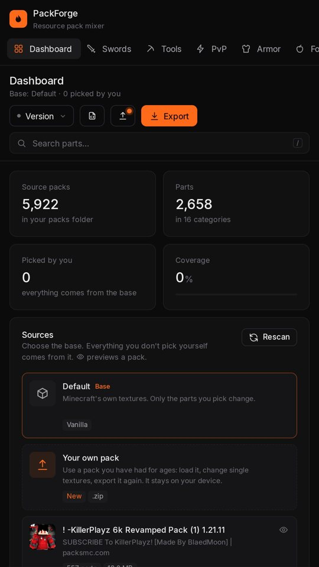
  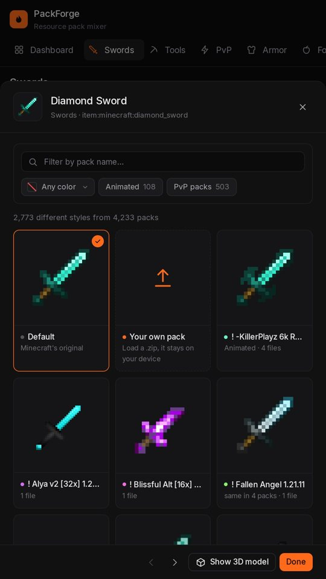

## How it works

1. **Open a category:** swords, tools, PvP, armor, food, items, blocks, ores, mobs, sky, particles, GUI, font, effects or sounds.
2. **Tap a part**, for example the diamond sword, and see every version the library has of it.
3. **Pick the one you like.** It goes straight into your mix.
4. **Check it in the live 3D preview**: in your hand, worn, while eating, in the inventory.
5. **Download pack**, choose your Minecraft version, and put the zip into your `resourcepacks` folder.

## See it before you download it

The live 3D preview shows every part the way you will see it in the game.

| In your hand | Custom skies | Totem pop |
|:---:|:---:|:---:|
| 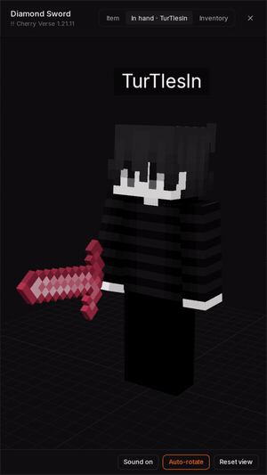 | 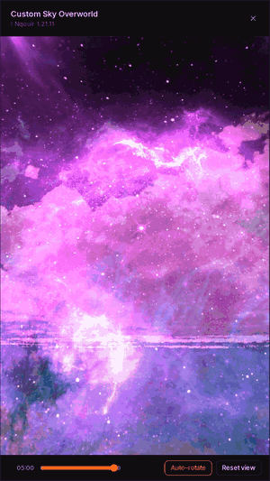 | 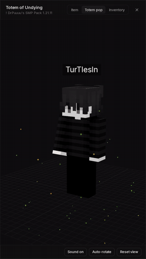 |
| **Blocks in 3D** | **Armor, worn** | **Eating** |
| 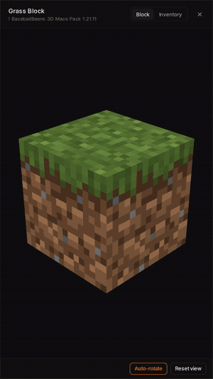 | 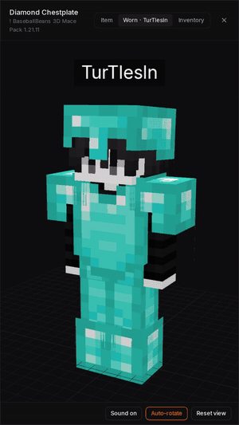 | 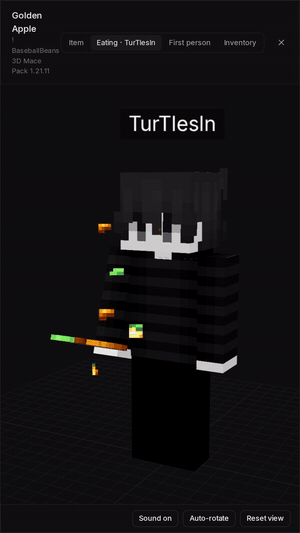 |

## Every part of the game

  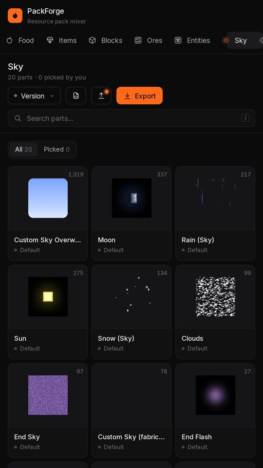
  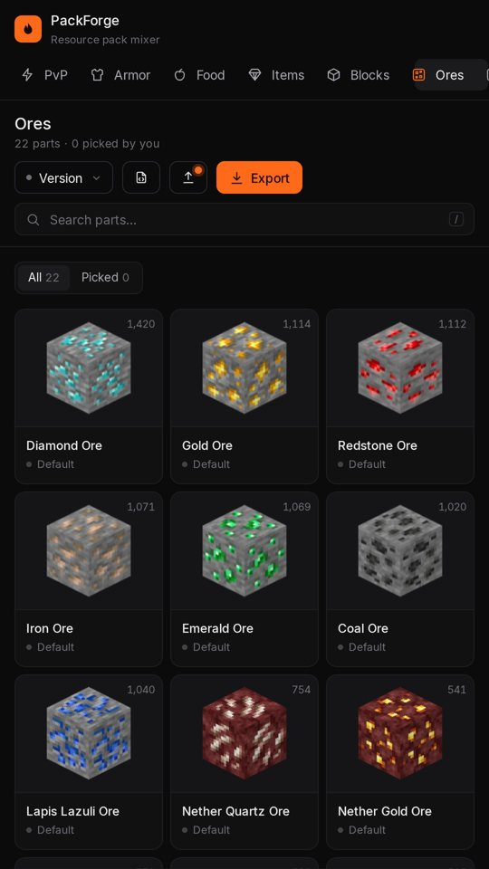
  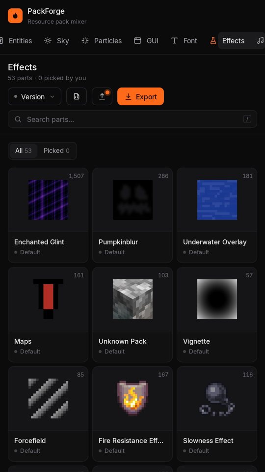

- **Filters:** by color with an eyedropper, animated only, PvP packs only
- **Sounds:** play a pack's sounds in the browser before you take them
- **Any 1.21 version:** the export is built for the exact version you play
- **Share your mix** with a short link, or save it as a small `.json` file
- **Remix:** every exported pack carries its mix, so a friend can open it and change it

## Bring your own pack

Load the pack you have used for years, even one that never came from PackForge. It is read **only in your
browser and never uploaded**. Its textures show up as **Your pack** right next to Default, so you can swap just
the one texture you never liked and export your pack again.

  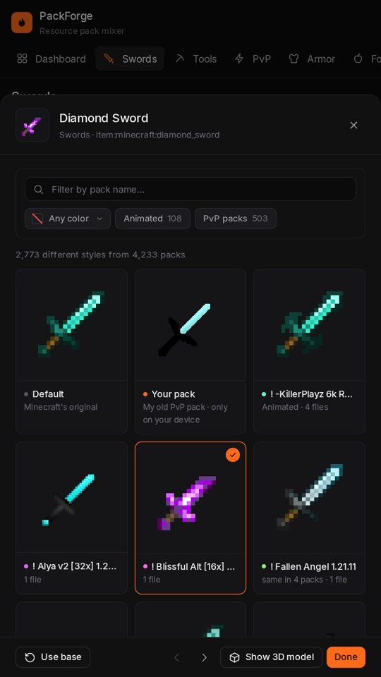

## Tools

  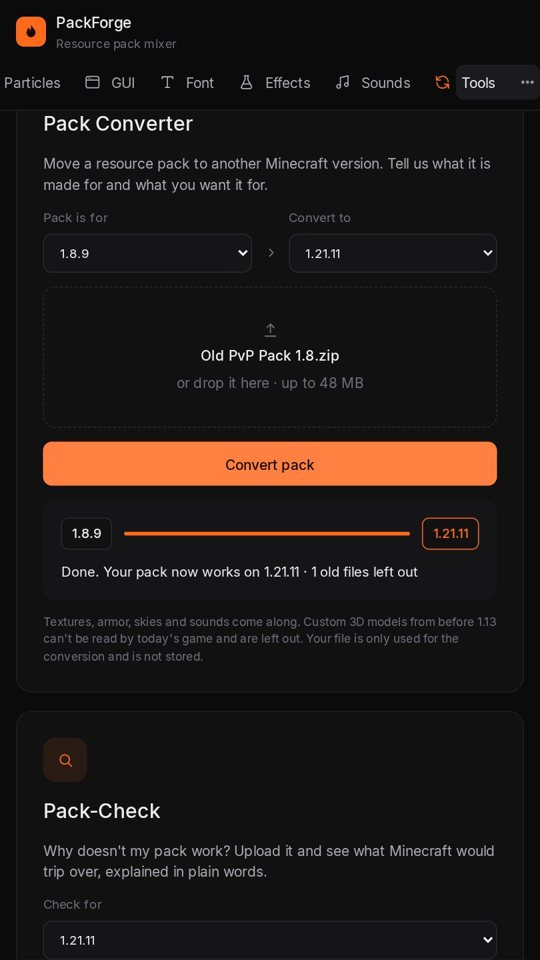

- **Pack Converter:** an old pack from 1.8 or later, moved to the version you play now (custom 3D models from before 1.13 are left out)
- **Pack-Check:** upload a pack and see in plain words why it doesn't work, and how to fix it
- **Which pack is this?** Upload a screenshot or a texture and find the pack it comes from

## FAQ

**Is it free?** Yes, completely, and you don't need an account.

**Which Minecraft versions?** Java Edition 1.21 up to the newest 1.21.x. The Pack Converter also takes older packs.

**Do my files get uploaded?** Your own pack never leaves your browser. The Converter and Pack-Check read an upload
only in memory to answer you; nothing is stored.

**Bedrock?** No, PackForge is made for Java Edition.

## About this repository

This repository only shows and explains PackForge. **The source code is not public.**
Found a bug or have an idea? Open an [issue](../../issues).

The textures belong to the authors of the packs they come from; PackForge credits them in every exported pack.
PackForge is not affiliated with Mojang or Microsoft. Minecraft is a trademark of Mojang Synergies AB.

© PackForge. All rights reserved.
